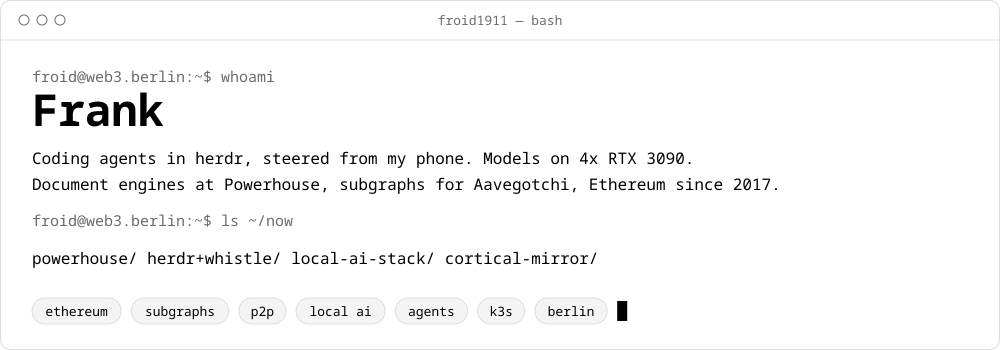
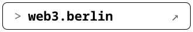
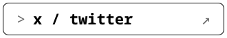
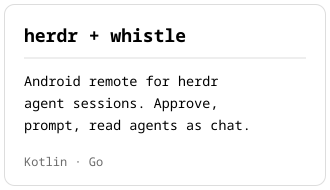
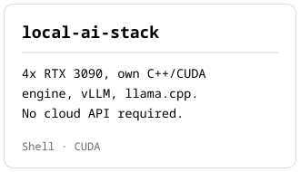
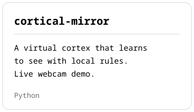
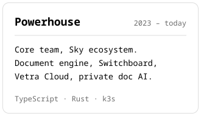
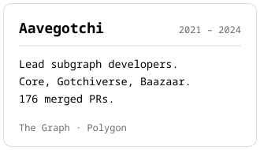
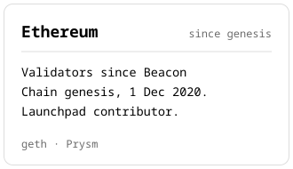

<a href="https://web3.berlin">
  <picture>
    <source media="(prefers-color-scheme: dark)" srcset="https://raw.githubusercontent.com/froid1911/froid1911/main/assets/header_dark.svg">
    
  </picture>
</a>

<a href="https://web3.berlin"><picture><source media="(prefers-color-scheme: dark)" srcset="https://raw.githubusercontent.com/froid1911/froid1911/main/assets/link_web3_dark.svg"></picture></a><a href="https://www.linkedin.com/in/fpfeift"><picture><source media="(prefers-color-scheme: dark)" srcset="https://raw.githubusercontent.com/froid1911/froid1911/main/assets/link_linkedin_dark.svg"></picture></a><a href="https://x.com/frankpfeift"><picture><source media="(prefers-color-scheme: dark)" srcset="https://raw.githubusercontent.com/froid1911/froid1911/main/assets/link_x_dark.svg"></picture></a><a href="mailto:frank@web3.berlin"><picture><source media="(prefers-color-scheme: dark)" srcset="https://raw.githubusercontent.com/froid1911/froid1911/main/assets/link_email_dark.svg"></picture></a>

### Building now

<a href="https://github.com/froid1911/whistle"><picture><source media="(prefers-color-scheme: dark)" srcset="https://raw.githubusercontent.com/froid1911/froid1911/main/assets/card_whistle_dark.svg"></picture></a><a href="https://github.com/froid1911/local-ai-stack"><picture><source media="(prefers-color-scheme: dark)" srcset="https://raw.githubusercontent.com/froid1911/froid1911/main/assets/card_local-ai_dark.svg"></picture></a><a href="https://github.com/froid1911/cortical-mirror"><picture><source media="(prefers-color-scheme: dark)" srcset="https://raw.githubusercontent.com/froid1911/froid1911/main/assets/card_cortical_dark.svg"></picture></a>

### Work

<a href="https://web3.berlin/work/powerhouse.html"><picture><source media="(prefers-color-scheme: dark)" srcset="https://raw.githubusercontent.com/froid1911/froid1911/main/assets/work_powerhouse_dark.svg"></picture></a><a href="https://web3.berlin/work/aavegotchi.html"><picture><source media="(prefers-color-scheme: dark)" srcset="https://raw.githubusercontent.com/froid1911/froid1911/main/assets/work_aavegotchi_dark.svg"></picture></a><a href="https://web3.berlin/work/lab.html"><picture><source media="(prefers-color-scheme: dark)" srcset="https://raw.githubusercontent.com/froid1911/froid1911/main/assets/work_validators_dark.svg"></picture></a>

Assets are generated by <code>scripts/build.py</code>. Edit the content there and re-run.
